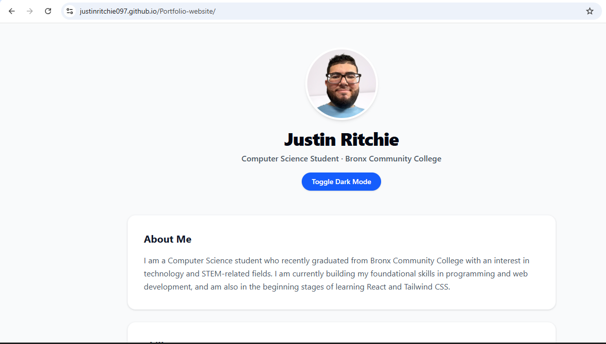

# Personal Portfolio Website

A personal portfolio website showcasing my web development projects, technical skills, and background in computer science.

## 🌐 Live Demo

**[View My Portfolio](https://justinritchie097.github.io/Portfolio-website/)**

## 📸 Preview

<!-- Add a screenshot of your portfolio website here -->



## 📝 About the Project

I built this portfolio website to showcase my projects, demonstrate my front-end development skills, and create a central place where potential employers and collaborators can learn more about me.

The website features information about my background, selected projects, and links to relevant resources.

## ✨ Features

- About section introducing my background
- Project and resource links
- Clean, accessible user interface

<!-- Remove or update any features that do not apply to your website. -->

## 🛠️ Built With

- **JavaScript (ES6+)** — Website functionality and interactivity
- **Tailwind CSS** — Styling and responsive design
- **HTML5** — Page structure
- **Git & GitHub** — Version control and project hosting

## 🚀 Getting Started

To run this project locally, follow these steps.

### Prerequisites

- Node.js and npm installed
- Git installed

### Installation

1. Clone the repository:

   ```bash
   git clone YOUR_REPOSITORY_URL
   ```

2. Navigate to the project directory:

   ```bash
   cd YOUR_REPOSITORY_FOLDER
   ```

3. Install dependencies:

   ```bash
   npm install
   ```

4. Start the development server:

   ```bash
   npm run dev
   ```

5. Open the local URL displayed in your terminal.

_These commands assume your project uses Vite. Adjust them if your setup differs._

## 📚 What I Learned

Through this project, I gained experience with:

- Styling interfaces with Tailwind CSS
- Structuring a front-end project
- Using Git and GitHub to manage and publish code
- Presenting projects and information through a website

## 🔮 Future Improvements

- Continue improving responsive design and accessibility
- Refine the user interface and overall visual consistency
- Add new projects as I expand my technical skills
- Optimize performance and maintainability

## 👨‍💻 Author

**Justin Ritchie**

- GitHub: [@justinritchie097](https://github.com/justinritchie097)
- LinkedIn: [My LinkedIn Profile](www.linkedin.com/in/justin-ritchie-902424289)

## 📄 License

This project is available for viewing and learning purposes. Please contact me before reusing substantial portions of the design or code.
